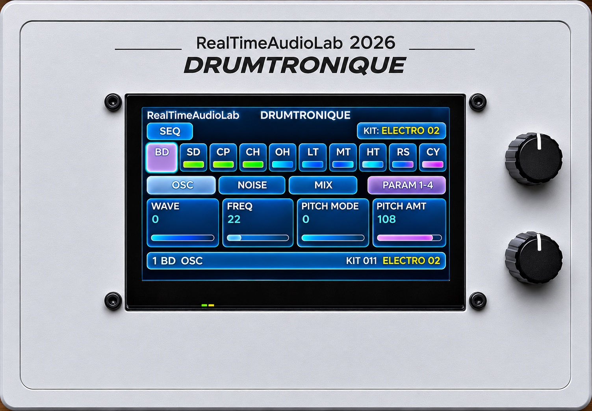
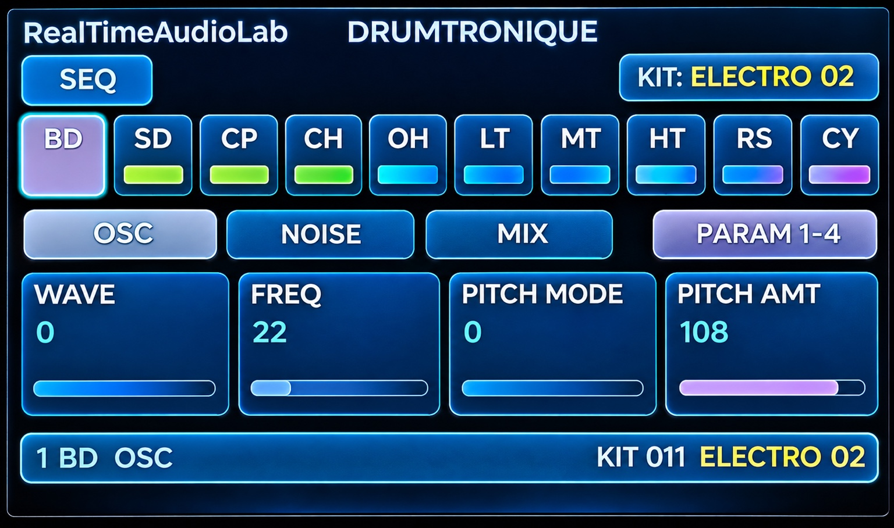
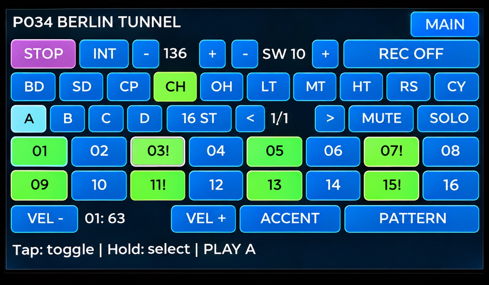

# RealTimeAudioLab DRUMTRONIQUE 2026

**Ten-Voice Digital Drum Synthesizer & Performance Sequencer**

  

English | [Deutsch](README_DE.md)

*Enclosure visualization — design preview, not a production unit.*

## A drum machine built around synthesis

DRUMTRONIQUE is an experimental embedded electronic percussion instrument by RealTimeAudioLab. It combines a ten-channel digital drum synthesis engine with a dedicated touchscreen sound editor, persistent kit management and an integrated performance sequencer. Rather than relying on recorded drum samples for its core sound generation, it makes percussion sounds directly editable through synthesis parameters.

The project builds on selected source code from [Drumtonic](https://github.com/fc79/drumtonic/tree/main) by **Federico Ciapi (fc79)**. His work provides an important foundation for this development. DRUMTRONIQUE extends that foundation with a dedicated embedded instrument architecture, new user interface, storage and sequencing workflows. It is not presented as an entirely original synthesis engine or an official successor to Drumtonic.

## Sound design

Ten instrument channels: BD, SD, CP, CH, OH, LT, MT, HT, RS and CY. These cover bass drum, snare, clap, closed/open hi-hats, low/mid/high toms, rimshot and cymbal roles. Each channel offers 24 sound parameters, organized into oscillator, noise and mix sections. The touchscreen provides direct parameter editing and instrument selection.

## Performance sequencer

- Ten instrument tracks; 16, 32 or 64 steps.
- Four pattern variations (A/B/C/D).
- Step editing, live recording, velocity, accents and swing.
- Track mute and solo.
- Internal tempo and external MIDI clock/transport synchronization.
- Stabilized external BPM display, inspired by the RTAL Phoenix implementation.
- SD pattern management: load, save, save as, rename, copy and clear.

## RealTimeAudioLab contributions

| Area | Extension |
|---|---|
| Embedded platform | ESP32-S3 integration and real-time audio scheduling |
| Interface | Dedicated 480 × 272 touch GUI and sound editor |
| MIDI | Instrument triggering, parameter CC mapping, kit selection and clock/transport integration |
| Storage | SD-based kit and pattern management, up to 128 slots each |
| Sequencing | Integrated ten-track performance sequencer and recording workflows |
| Hardware | Dedicated enclosure concept and standalone instrument integration |
| Sound matching | Separate experimental WAV-to-synthesis parameter optimization project |

The table describes RTAL integration and extensions, not a line-by-line audit of upstream code. See [FEATURES](FEATURES.md) and [CREDITS](CREDITS.md).

## Technical platform

| Component | Configuration |
|---|---|
| MCU | ESP32-S3 |
| Memory | 16 MB flash / 8 MB PSRAM target |
| Display | JC4827W543, 480 × 272, GT911 touch |
| Audio | 44.1 kHz / 256-frame configuration used in the development line; I2S output |
| Sound generation | Ten digital percussion channels |
| Storage | SD card |
| Control | Touch and MIDI |

## What comes next?

Advanced step editing, probability, ratchets, microtiming, parameter locks, polymetric tracks, pattern chaining, song arrangements and extended performance tools are part of the development roadmap. These features are not claimed as hardware-validated in the current baseline.

A parallel **DRUMTRONIQUE SOUND MATCHER** prototype investigates offline analysis of WAV recordings and optimization of the synthesis parameters to approximate the reference sound without using that recording as the playback source. Exact reconstruction is not guaranteed.

See the [roadmap](ROADMAP.md).

## Development status

The V0.5A FIX2 baseline has passed the project's hardware checks, including the external clock display update. The project remains under active development; this teaser is not a final firmware release or a production specification.

## Credits and licensing

Original Drumtonic project: **Federico Ciapi (fc79)** — https://github.com/fc79/drumtonic

Upstream licensing is recorded in project history as GPL-3.0-only. The applicable original notices and license text must be retained in any distributed derivative firmware, with corresponding source provided as required. This teaser does not include firmware or independently verify the upstream license revision. See [CREDITS.md](CREDITS.md).

**RealTimeAudioLab · 2026**

*Design the sound. Program the rhythm. Perform the machine.*
