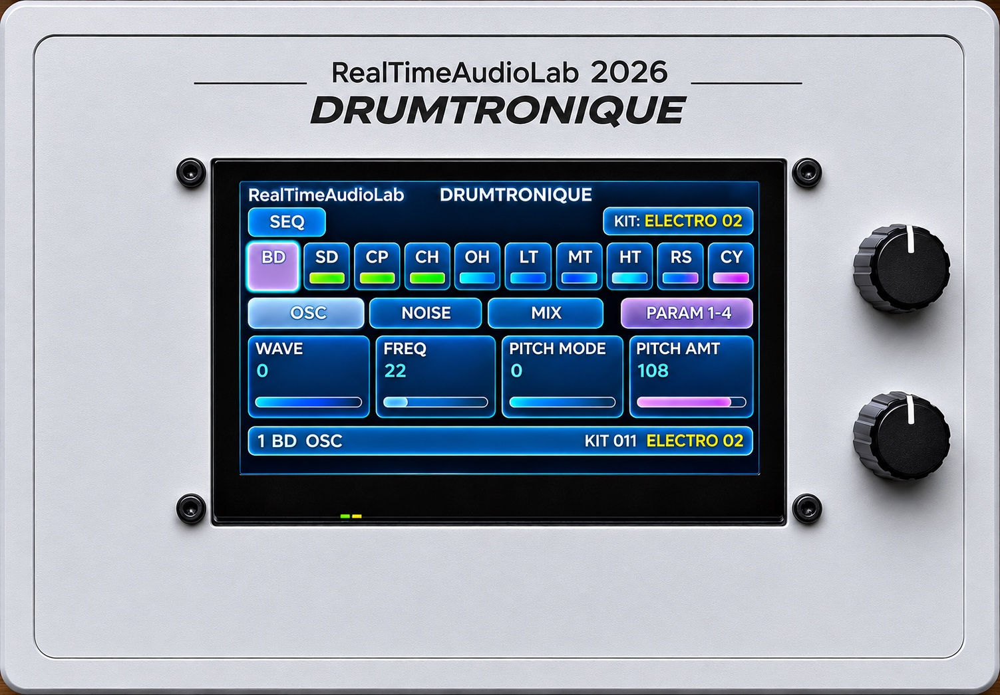
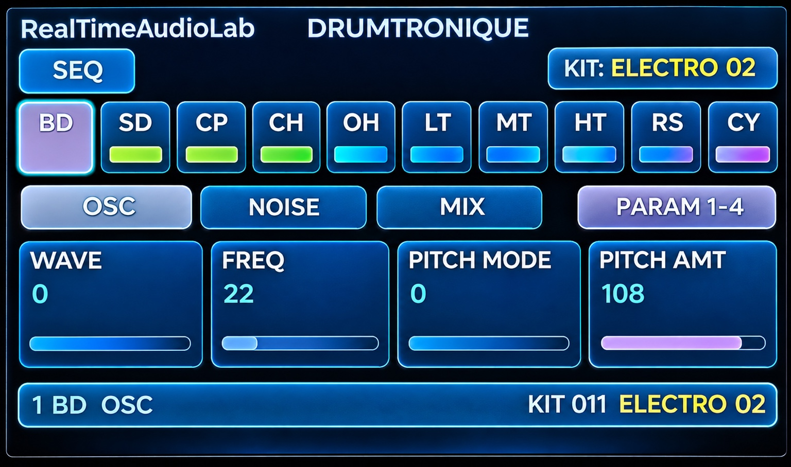
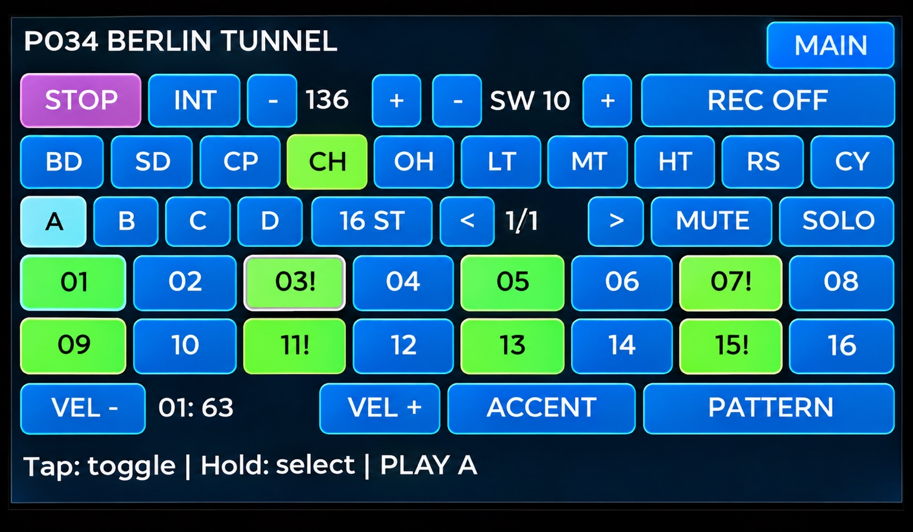

# RealTimeAudioLab DRUMTRONIQUE 2026

**Zehnkanaliger digitaler Drum-Synthesizer mit Performance-Sequencer**

[English](README.md) | Deutsch

*Gehäusevisualisierung – Designvorschau, kein Seriengerät.*

## Elektronische Percussion als eigenständiges Instrument

DRUMTRONIQUE verbindet digitale Drum-Synthese, direkte Klanggestaltung und rhythmische Performance in einem eigenständigen ESP32-S3-Instrument. Die Klänge werden durch Synthese erzeugt und lassen sich über zahlreiche Parameter individuell gestalten, statt lediglich aufgezeichnete Samples abzuspielen.

Die Entwicklung übernimmt ausgewählte Code-Teile aus dem Projekt [Drumtonic](https://github.com/fc79/drumtonic/tree/main) von **Federico Ciapi (fc79)**. Seine Arbeit bildet eine wichtige Grundlage. RealTimeAudioLab erweitert diese um eine eigene Embedded-Integration, Touch-Oberfläche, Speicherverwaltung und einen integrierten Sequencer. DRUMTRONIQUE ist weder eine vollständig neu entwickelte Synthese-Engine noch ein offizieller Nachfolger des Originals.

## Sound-Editor

Zehn Instrumentenkanäle (BD, SD, CP, CH, OH, LT, MT, HT, RS, CY) mit jeweils 24 Klangparametern. Die Bereiche OSC, NOISE und MIX ermöglichen die Gestaltung von Bassdrums, Snares, Claps, Hi-Hats, Toms, Rimshots und Beckenklängen.

## Performance-Sequencer

- Zehn Spuren mit 16, 32 oder 64 Steps.
- Vier Pattern-Variationen A/B/C/D.
- Step- und Live-Recording, Velocity, Accent und Swing.
- Mute und Solo pro Instrument.
- Interne und externe MIDI-Clock einschließlich Transport.
- Stabilisierte externe BPM-Anzeige nach dem RTAL-Phoenix-Prinzip.
- Pattern laden, speichern, umbenennen, kopieren und löschen.

## Erweiterungen durch RealTimeAudioLab

| Bereich | RTAL-Erweiterung |
|---|---|
| Plattform | ESP32-S3-Integration und Echtzeit-Audioverarbeitung |
| Bedienung | Eigene Touch-GUI mit 480 × 272 Pixeln |
| Klanggestaltung | Grafischer Editor für die zehn Instrumente |
| MIDI | Notensteuerung, CC-Zuordnung, Kit-Auswahl und Synchronisation |
| Speicher | Bis zu 128 Drum-Kits und 128 Patterns auf SD-Karte |
| Sequencer | Integrierter Zehnspur-Sequencer mit Aufnahmefunktionen |
| Hardware | Eigenständiges Gehäuse- und Instrumentenkonzept |
| Sound Matching | Separater experimenteller WAV-zu-Syntheseparameter-Optimierer |

Diese Übersicht beschreibt die RTAL-Integration und Erweiterungen, keine zeilenweise Abgrenzung des übernommenen Quellcodes.

## Technische Plattform

ESP32-S3, Zielkonfiguration 16 MB Flash und 8 MB PSRAM, JC4827W543 mit GT911-Touch, I2S-Audio, SD-Karte und MIDI. In der Entwicklungslinie wurde eine Audiokonfiguration von 44,1 kHz mit 256 Frames verwendet.

## Zukünftige Entwicklung

Geplant beziehungsweise in Entwicklung sind Probability, Ratchets, Microtiming, Parameter Locks, polymetrische Spuren, Pattern-Verkettung, Song-Modus und erweiterte Performance-Funktionen. Diese werden noch nicht als hardwarebestätigte Funktionen der aktuellen Referenz ausgewiesen.

Der parallel entwickelte **DRUMTRONIQUE SOUND MATCHER** soll WAV-Dateien analysieren und passende Syntheseparameter ermitteln. Das Ziel ist eine möglichst ähnliche synthetische Rekonstruktion, keine garantierte exakte Kopie des Samples.

Details: [Roadmap](ROADMAP.md) · [Features](FEATURES.md) · [Credits](CREDITS.md)

## Entwicklungsstand und Lizenz

V0.5A FIX2 ist die hardwarebestätigte Referenz. Das Projekt befindet sich weiterhin in Entwicklung. Dieser Teaser enthält keine Firmware.

Vielen Dank an **Federico Ciapi (fc79)** für Drumtonic. Die im Projektverlauf dokumentierte Upstream-Lizenz ist GPL-3.0-only. Vor einer Firmware-Veröffentlichung müssen die konkrete Lizenzrevision und Originalhinweise geprüft und die entsprechenden GPL-Pflichten erfüllt werden.

**RealTimeAudioLab · 2026**
