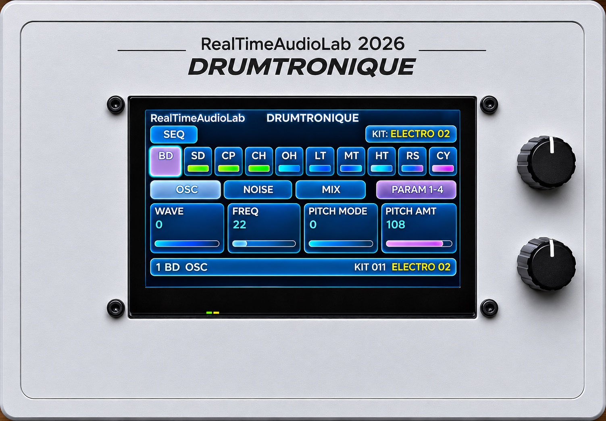

# Introducing RealTimeAudioLab DRUMTRONIQUE 2026

**Ten voices. Ten tracks. One dedicated electronic percussion instrument.**

DRUMTRONIQUE combines digital drum synthesis, a dedicated touchscreen sound editor and a powerful performance sequencer on the ESP32-S3 platform. Shape each instrument, create your own kits and build evolving rhythms with four pattern variations, velocity, accents, swing and MIDI synchronization.

Built on selected code from Federico Ciapi's [Drumtonic](https://github.com/fc79/drumtonic), the project adds RealTimeAudioLab's embedded integration, touch interface, persistent storage and sequencing workflows.

Coming next: advanced step modulation, probability, ratchets, microtiming, polymetric rhythms, song arrangements and experimental WAV-to-synthesis sound matching.

**Currently in development — V0.5A FIX2 hardware-validated baseline.**

---

## Deutsch

Zehn Instrumente, zehn Sequencer-Spuren und eine eigenständige Touch-Oberfläche: DRUMTRONIQUE verbindet digitale Drum-Synthese mit intuitiver Klanggestaltung und rhythmischer Performance. Auf Grundlage ausgewählter Code-Teile von Federico Ciapis Drumtonic entwickelt RealTimeAudioLab ein eigenständiges ESP32-S3-Instrument mit SD-Speicherverwaltung, MIDI-Synchronisation und integriertem Sequencer. Weitere kreative Sequencer-Funktionen und experimentelles WAV-Sound-Matching befinden sich in Entwicklung.
